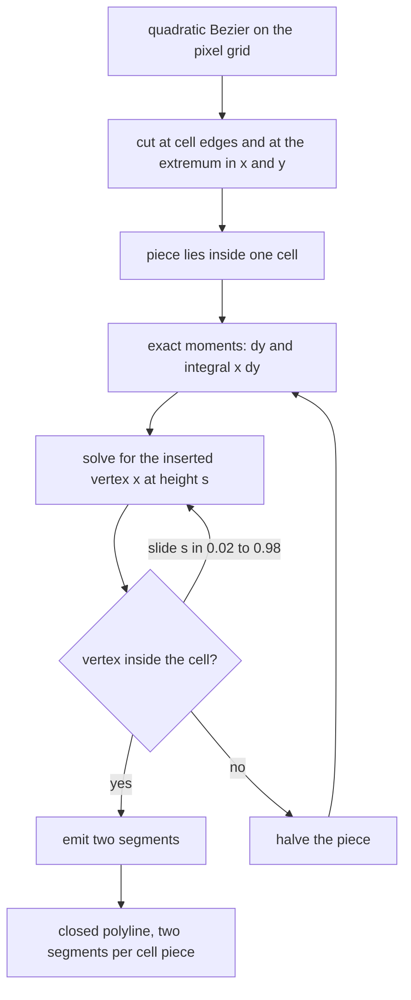
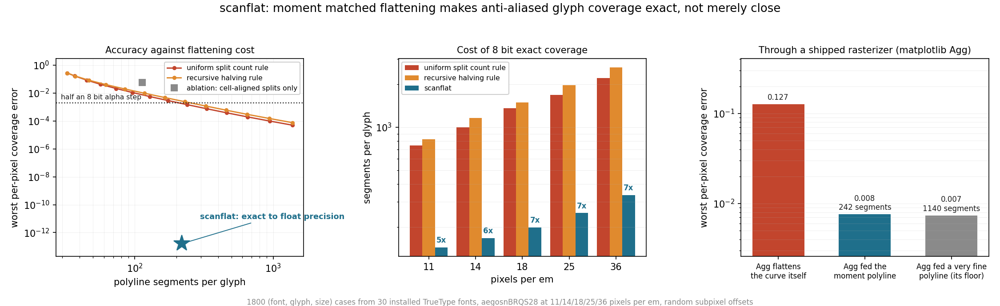
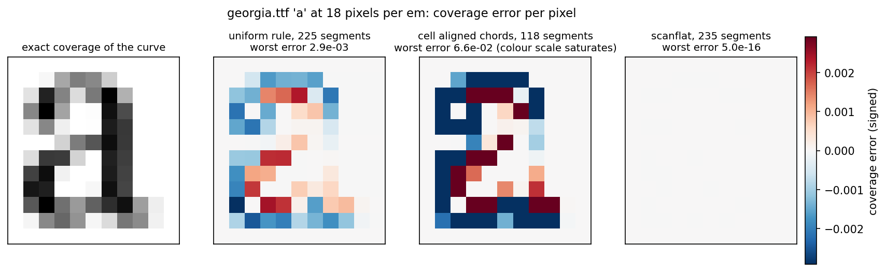

# scanflat

Exact anti-aliased glyph coverage from an ordinary polyline, by matching two
moments per pixel cell instead of bounding a curve tolerance.

## Problem

No text rasterizer renders curves. It chops every quadratic Bezier in the font
into a polyline first, then fills the polygon. The chopping is driven by a
geometric tolerance: subdivide until the distance between the curve and its
chord is under some fraction of a pixel. That is a sensible thing to bound and
it converges, but it converges at one over n squared, so pushing the rendered
result close to the true coverage costs segments, and reaching the true
coverage costs infinitely many of them. Every glyph on every screen is
therefore a polygon of slightly the wrong shape, and the error lands in the
anti-aliased alpha: pixels come out one to thirty of the 255 levels away from
the coverage the outline actually asks for.

The tolerance is also aimed at the wrong quantity. An exact-area scanline
rasterizer, the cell accumulation structure that FreeType's smooth renderer
and Anti-Grain Geometry are both built on, never looks at how far the polyline
strays from the curve. Inside one pixel cell it reduces the boundary to two
accumulated numbers, and nothing else about the geometry survives.

## What it does

`scanflat` flattens a glyph outline so that those two numbers come out right.

For every quadratic in the outline it

1. cuts the curve at every pixel cell edge it crosses and at its extremum in
   each axis, so each piece lies inside exactly one cell,
2. computes the piece's two moments analytically: `dy`, and the integral of
   `x dy` along it (two point Gauss-Legendre is exact here, the integrand is a
   cubic),
3. emits two straight segments through one inserted vertex chosen so the pair
   reproduces both moments exactly.

The inserted vertex has one degree of freedom left over, its height inside the
cell, which is used to keep it inside the cell; if even that is not enough the
piece is halved and the construction repeated. The result is a closed polyline
that any unmodified polygon rasterizer turns into the exact coverage of the
curved outline, to float precision, on every pixel.

The repository also contains the measurement harness: the exact-area
rasterizer, a point-sampling rasterizer, the two standard tolerance rules as
baselines, an ablation that keeps the cell-aligned cuts but drops the moment
matching, and a sweep over the TrueType fonts installed on the machine.

## Why it is interesting

- **The target is wrong, not merely too loose.** Shipped flatteners bound a
  geometric quantity that the rasterizer never reads. Matching what it does
  read turns an asymptotic approximation into an exact answer.
- **Exact at a bounded, computable cost.** Two segments per cell crossing, not
  a tolerance that has to be guessed and that can only ever get close.
- **The output stays a plain polyline.** Some rasterizers avoid flattening by
  walking quadratic edges per scanline. This needs none of that: the exactness
  is carried by the vertex positions, so a line-only rasterizer gets exact
  curved coverage with no change to its code.
- **It inverts the usual intuition.** The polyline it produces sits further
  from the true outline than the tolerance polyline it beats, by a factor of
  about two hundred, and still renders exactly. Geometric fidelity and
  rendering fidelity are not the same objective.

## Architecture

FigJam board: https://www.figma.com/board/p1mBG0Ibk2iqhn5aqsfZUT

The board shows the whole path: a font file on disk becomes an outline, the
outline is placed on a pixel grid, the grid-aligned cuts and the moment match
produce the polyline, and that polyline plus the baselines plus the true curve
all go through the same rasterizer so the only difference measured is the
flattening.

The algorithm itself, per curve:



## Results



The metric is per-pixel coverage error: the difference between what the
rasterizer produces for the flattened polyline and the exact coverage of the
curved outline, measured on every pixel the glyph touches. The corpus is 1800
(font, glyph, size) cases built from 30 TrueType fonts installed on the test
machine, the glyphs `aegosnBRQS28`, sizes 11, 14, 18, 25 and 36 pixels per em,
each placed at a random subpixel offset. That is 431,235 pixels, of which
139,783 are partially covered and therefore have anti-aliased alpha.

The baseline is the two standard flattening rules: a closed-form split count
taken from the second-difference bound, and recursive halving on the same
chord-deviation test. Both are swept over tolerances from one half of a pixel
down to two to the minus seventeen.

| | segments per glyph | worst per-pixel coverage error |
|---|---|---|
| uniform split count rule, at scanflat's segment budget | 217 | 2.0e-03 |
| recursive halving rule, at scanflat's segment budget | 217 | 3.0e-03 |
| ablation: cell-aligned splits, plain chords | 113 | 5.9e-02 |
| uniform rule, tuned until the 8 bit output is exact | 1389 | under half a step, by construction |
| recursive rule, tuned until the 8 bit output is exact | 1611 | under half a step, by construction |
| **scanflat** | **219** | **1.6e-13** |

Three things changed. First, the error itself: at a matched segment budget the
tolerance rules are off by about two parts in a thousand at their worst pixel,
and scanflat is off by two parts in ten million million, which is float
rounding. Not one of the 139,783 anti-aliased pixels in the corpus came out
with the wrong 8 bit alpha. Second, the cost: making the tolerance rules
merely 8 bit exact takes 1389 and 1611 segments per glyph against scanflat's
219, so exactness arrives at 6.4 and 7.4 times lower cost than the
approximation does. That ratio is 5.2x at 11 pixels per em and 6.6x at 36, so
it is not an artifact of one size. Third, a real rasterizer agrees: feeding
matplotlib's Agg backend the moment-matched polyline instead of the curve
drops its worst per-pixel error from 0.127 to 0.008, which is Agg's own
fixed-point floor, and gets there with 242 segments where a conventional fine
flattening needs 1140 for the same result.

The ablation row is the load-bearing one. Cutting at the cell edges and taking
plain chords, which is the alignment half of the method with the moments left
out, is worse than the tolerance rule at the same cost: 60.1 percent of the
anti-aliased pixels come out with the wrong 8 bit alpha. The grid alignment on
its own buys nothing. The moments are the mechanism.



Per-pixel error for one glyph. The colour scale is set by the uniform rule at
a matched segment budget; the ablation panel saturates it; the scanflat panel
is empty because there is nothing left to show.

## How to run it

```
pip install -r requirements.txt
python -m unittest discover -s tests -t .      # correctness gates, about one second
python demo.py                                 # the full sweep, about seven minutes
python make_chart.py                           # docs/before_after.png
python make_glyph_figure.py                    # docs/glyph_error.png
```

`demo.py` reads the fonts installed on the machine. On Windows that is
`C:/Windows/Fonts/*.ttf` with no configuration. On another platform, point
`scanflat.outline.font_files` at a directory of TrueType files, for example
`/usr/share/fonts/truetype/**/*.ttf`. Only `glyf` outlines are handled, so
CFF flavoured OpenType files are skipped with a clear error.

A smaller run for a quick look:

```
python demo.py --fonts 4 --extras 20 --out docs/metrics.json
```

Using it on one glyph:

```python
from scanflat.outline import open_font, scaled_glyph
from scanflat.flatten import flatten_moment
from scanflat.raster import coverage, fill, pixel_box

font = open_font("C:/Windows/Fonts/georgia.ttf")
glyph = scaled_glyph(font, font.getBestCmap()[ord("a")], ppem=18.0, dx=0.37, dy=0.61)

polyline = flatten_moment(glyph)          # lines only, ready for any polygon filler
box = pixel_box(glyph)
exact = fill(coverage(glyph, box))        # coverage of the true curve
got = fill(coverage(polyline, box))       # coverage of the polyline
print(abs(got - exact).max())             # 5e-16
```

## Example outputs

The end of a full `python demo.py` run:

```
corpus: 1800 (font, glyph, size) cases
  200/1800  48s
  ...
evaluated 1800 cases over 30 fonts in 358 s
agg anchor ...
wrote docs/metrics.json
  worst coverage error 1.60e-13, wrong 8 bit pixels 0 of 139783 edge pixels
  segments per glyph for 8 bit exact: uniform 1388.9, recursive 1611.0, scanflat 217.0
```

One glyph, Candara Bold `e` at 13 pixels per em, through the exact-area
rasterizer:

```
cell aligned chords   54 segments   worst coverage error 1.955e-01
scanflat             108 segments   worst coverage error 4.441e-16
```

Numbers for every run are written to `docs/metrics.json`, including the full
error against segment count ladder for both baselines, the per size
breakdowns, the ablation, and the Agg comparison case by case.

## Limitations

These are measured, not guessed. The numbers come from 150 cases sampled
across the same corpus and are in `docs/metrics.json` under `limits`.

- **The polyline belongs to one pixel grid.** It encodes the moments of the
  curve relative to specific cell edges, so moving the glyph by half a pixel
  destroys the exactness: worst per-pixel error goes from 1.6e-13 to 7.4e-03,
  which is roughly where a cell-aligned chord polyline sits. Flattening is
  already size dependent in every renderer, since the tolerance is in pixels,
  but this is stricter: subpixel positioning needs a re-flatten, and a cached
  polyline cannot be reused across positions.
- **Exactness is relative to one rasterizer model.** It is exact for the
  exact-area scanline model. Under a point-sampling rasterizer at four by four
  samples per pixel the worst error is 5.6e-02, which is one sample out of
  sixteen: the moments say nothing about where inside a cell the boundary is.
- **The polyline is not a good approximation of the outline.** Its vertices
  sit deliberately off the curve, 3.5e-02 pixels away on average at the worst
  point, against 1.5e-04 pixels for the tolerance polyline that merely matches
  the 8 bit output, a factor of 240. Do not use it for hit testing, stroking,
  offsetting or outline export. It is a rendering-equivalent encoding, not a
  shape.
- **The baseline comparison is censored against scanflat.** 91 of the 1800
  cases for the uniform rule and 55 for the recursive rule never reached 8 bit
  exactness at any tolerance in the sweep, down to two to the minus seventeen.
  Those are the hardest cases and they are dropped from the ratios, so the
  6.4x and 7.4x are understatements.
- **It costs about twice the vertices of a cell-aligned chord polyline**, two
  segments per cell piece instead of one. The comparison above is made in
  segments, and separately in cell crossings, which is the unit a scanline
  rasterizer actually works in; the ratio is 6.8x there.
- **Only quadratic outlines.** The `glyf` table stores quadratics, which is
  the corpus here. The same construction works for cubics, since a cubic's
  x dy integrand is degree five and three-point Gauss is exact for it, but
  cutting at cell edges then needs cubic root finding and that is not
  implemented.

## Repository layout

```
scanflat/geom.py       segment primitives, exact moments, grid-critical parameters
scanflat/raster.py     exact-area rasterizer and a point-sampling rasterizer
scanflat/flatten.py    the two baseline rules, the ablation, and the method
scanflat/outline.py    TrueType glyf outline extraction
scanflat/bench.py      the corpus sweep and its metrics
demo.py                runs everything, writes docs/metrics.json
make_chart.py          docs/before_after.png
make_glyph_figure.py   docs/glyph_error.png
tests/                 correctness gates
```

## How the exactness is checked

The claim is strong enough that it is worth saying how it is verified rather
than asserted.

- The exact-area rasterizer is validated against an independent point-sampling
  rasterizer, which converges to it as the sample count rises. On Arial `a` at
  16 pixels per em the worst disagreement falls 1.26e-01, 4.24e-02, 2.14e-02,
  1.28e-02, 2.81e-03 for 4, 8, 16, 32 and 64 samples per pixel per axis.
- Total coverage is checked against the Green's theorem area of the contour.
- The two-point Gauss moment is checked against a twenty thousand step Riemann
  sum, and subdivision is checked to preserve both moments.
- Every piece produced by the cell cutting is checked to lie inside a single
  cell.
- The uniform rule is checked to actually respect the tolerance it is given,
  so the baseline is not a straw man.
- The end-to-end exactness is checked on random closed quadratic blobs and on
  real installed fonts, requiring both a float-precision match and an exact 8
  bit match.
